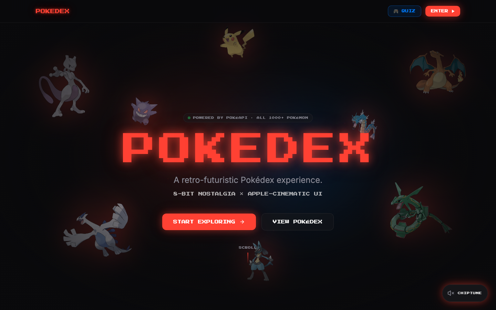
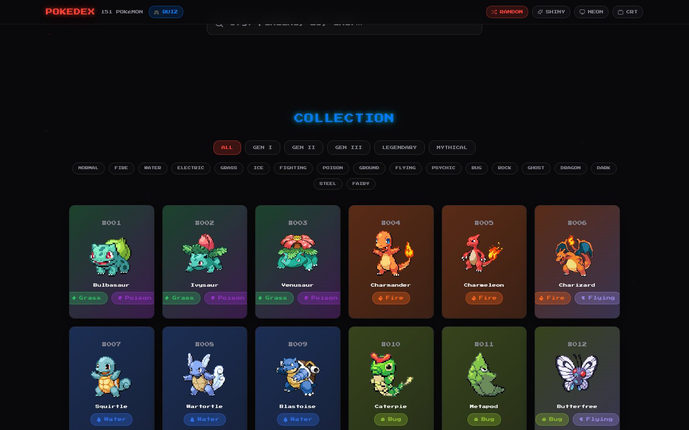
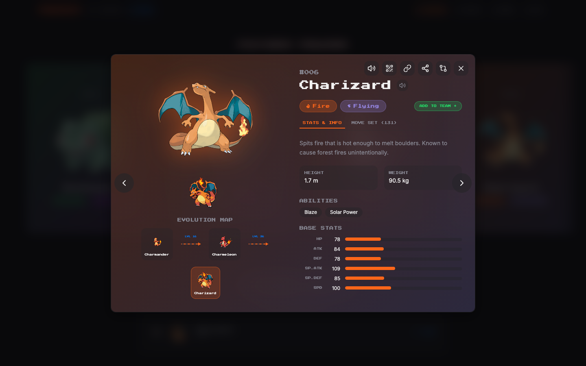
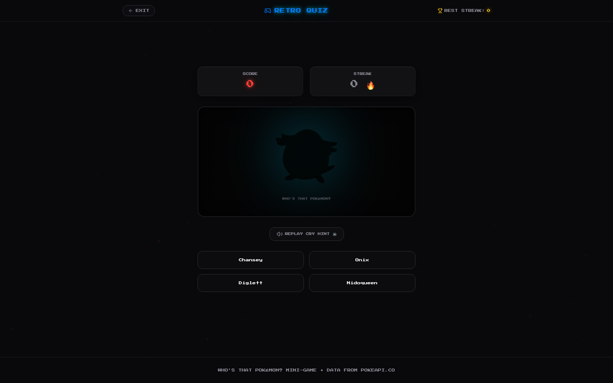
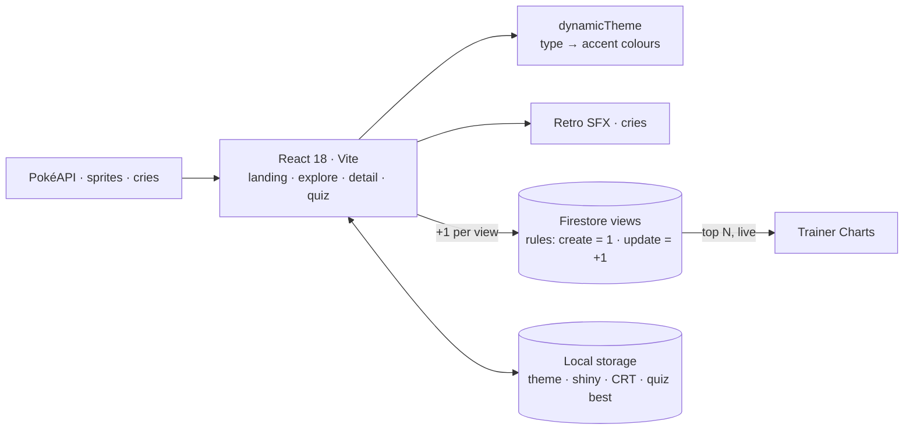

<div align="center">



<p>
  <a href="https://pixel-dex-psi.vercel.app"></a>
  
  
  
</p>

<p><em>Pixel art meets cinema, with a modern soul: a fan dex with animated pixel sprites, parallax scenes,<br>
real cries, shiny mode, CRT themes, a silhouette quiz and a global chart of the most-viewed entries.</em></p>



</div>


## The idea

The second take on the dex trades the dashboard for atmosphere. It boots like an old handheld, scrolls pixel hills in parallax behind animated sprites, plays each entry's real cry with retro UI sounds, and re-tints the whole interface to the type of whatever you are looking at. Underneath it is still fast and practical: instant search, filters, deep detail pages and shareable links.

> **A global chart that cannot be cheated from the browser.** Every view adds one to that entry's counter in Firestore. The security rules only allow a document to be created with a count of 1, or updated by exactly +1 with the same id, so the Trainer Charts stay honest without a server.


## Features

| | |
|---|---|
| **Cinematic dex** | An intro boot animation, a parallax hero and a featured carousel of legendaries. |
| **Search and filters** | Instant search by name or number, filtered by type, generation, legendary and mythical. |
| **Deep detail** | Base stats, abilities, evolution map, move set, size and dex lore, at `/pokemon/:id`. |
| **Real cries and SFX** | Every entry plays its cry; the interface has 8-bit sound effects with a mute switch. |
| **Dynamic theme** | The accent colours follow the entry's first and second type. |
| **Shiny mode** | One toggle flips every sprite, card and artwork to the shiny variant. |
| **Retro themes** | *Neon* and *Ultra-Retro*, an optional CRT scanline effect and hand-made 8-bit icons for all 18 types. |
| **Quiz** | Silhouette-and-cry guessing at `/quiz`, with score, streak and best score. |
| **Team builder** | A six-slot team with type-matchup awareness. |
| **Trainer Charts** | A live leaderboard of the most-viewed entries, from Firestore. |
| **TR / EN** | i18next with browser language detection; mobile-first. |

<table>
  <tr>
    <td width="33%"></td>
    <td width="33%"></td>
    <td width="33%"></td>
  </tr>
  <tr>
    <td align="center">Explore</td><td align="center">Detail</td><td align="center">Quiz</td>
  </tr>
</table>


## How it fits together



| Route | Page |
|---|---|
| `/` | Landing with the boot intro |
| `/explore` | Search, filters, carousel, collection grid, team builder |
| `/pokemon/:id` | The detail page, shareable |
| `/quiz` | Silhouette and cry quiz |


## Türkçe özet

**Pixel-Dex**, Pokédex'in ikinci, daha sinematik sürümü: açılış animasyonu, paralaks piksel sahneler, hareketli piksel sprite'lar, gerçek sesler ve retro efektler. Arama ve filtreler, ayrıntılı sayfalar, shiny modu, Neon ve Ultra-Retro temaları, isteğe bağlı CRT tarama çizgileri, girdinin tipine göre değişen tema rengi, siluet ve sesle bilmece ve takım kurucu var. En çok görüntülenenleri gösteren küresel "Trainer Charts" Firestore'da tutuluyor; güvenlik kuralları sayacın yalnızca birer birer artmasına izin veriyor. Arayüz Türkçe ve İngilizce.


## Development

```sh
npm install      # or bun install
npm run dev
npm test         # vitest
npm run build
```

The Firebase web config lives in `src/lib/firebase.ts`; deploy `firestore.rules` and `firestore.indexes.json` with the Firebase CLI.

```
src/components/   intro, hero carousel, search, cards, modal, collection grid, team builder, leaderboard, settings bar
src/lib/          pokemon (PokéAPI), typeMatchup, dynamicTheme, viewTracker, sfx, i18n, firebase
src/hooks/        usePokemon, useAllPokemonNames, useViews
```

<div align="center">
<br>
<a href="https://github.com/kutluhangil"></a>
<sub>MIT licensed · a non-commercial fan project · Pokémon and all related names are trademarks of Nintendo, Game Freak and The Pokémon Company · data from PokéAPI · the sprite in the banner is a generic invented creature.</sub>
</div>
