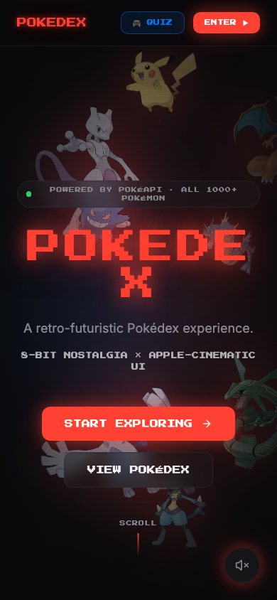
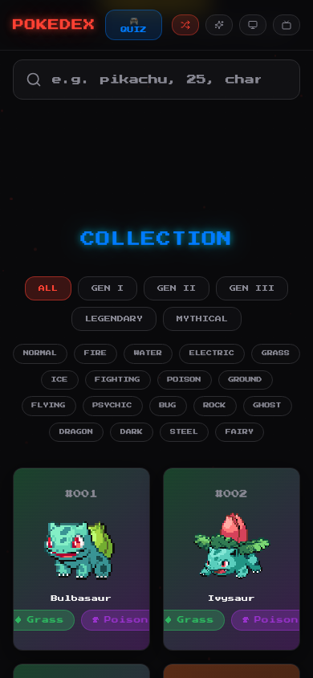
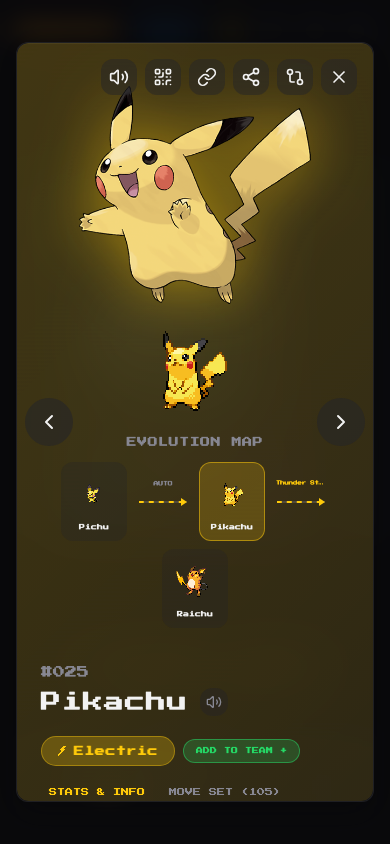

<div align="center">

<br />


<br /><br />

```
  ██████╗  ██████╗ ██╗  ██╗███████╗██████╗ ███████╗██╗  ██╗
  ██╔══██╗██╔═══██╗██║ ██╔╝██╔════╝██╔══██╗██╔════╝╚██╗██╔╝
  ██████╔╝██║   ██║█████╔╝ █████╗  ██║  ██║█████╗   ╚███╔╝
  ██╔═══╝ ██║   ██║██╔═██╗ ██╔══╝  ██║  ██║██╔══╝   ██╔██╗
  ██║     ╚██████╔╝██║  ██╗███████╗██████╔╝███████╗██╔╝ ██╗
  ╚═╝      ╚═════╝ ╚═╝  ╚═╝╚══════╝╚═════╝ ╚══════╝╚═╝  ╚═╝
```

### **A retro-futuristic Pokédex** — pixel art meets cinematic, 8-bit nostalgia with a modern soul.

[Live Demo](https://pixel-dex.vercel.app) · [Report Bug](https://github.com/kutluhangil/PokeDEx_v2.0/issues) · [Request Feature](https://github.com/kutluhangil/PokeDEx_v2.0/issues)

</div>

---

## 🇹🇷 Türkçe Açıklama

**Pixel-Dex**, tüm Pokémon'ları tek bir sinematik panelden keşfetmenizi sağlayan retro-fütüristik bir Pokédex uygulamasıdır. Pikselli sanat ile modern arayüzü birleştirir: animasyonlu spritelar, parıltılı (shiny) modu, CRT ekran efekti ve iki ayrı retro tema sunar. Her Pokémon'un istatistiklerini, evrim zincirini, hareketlerini ve gerçek seslerini (cry) dinleyebilir; **"Who's That Pokémon?"** mini oyunuyla bilginizi sınayabilir ve global liderlik tablosunda en çok bakılan Pokémon'ları görebilirsiniz. Veriler [PokeAPI](https://pokeapi.co)'den canlı çekilir, global görüntülenme sayıları ise Firebase Firestore üzerinde tutulur.

---

## ✦ What is Pixel-Dex?

**Pixel-Dex** is a retro-futuristic Pokédex that turns browsing Pokémon into an experience. Animated pixel sprites, cinematic parallax, glowing neon UI, and real Pokémon cries — all wrapped in a fast, mobile-first React app.

Search the entire roster, inspect deep stats and evolution chains, build a dream team, climb the global leaderboard, and test yourself in the **Who's That Pokémon?** quiz. No login required. Just open and explore.

---

## ⚡ Features

| Feature | Description |
|--------|-------------|
| 🔴 **Cinematic Pokédex** | Parallax hero, intro boot animation, and a featured carousel of legendaries |
| 🔍 **Smart Search & Filters** | Instant search by name or number, filtered by type, generation, legendary & mythical |
| 🧬 **Deep Detail View** | Base stats, abilities, evolution map, move set, height/weight, and Pokédex lore |
| 🔊 **Real Pokémon Cries** | Every entry plays its authentic cry — plus retro UI sound effects |
| 🏆 **Global Leaderboard** | "Trainer Charts" rank the most-viewed Pokémon worldwide via Firebase Firestore |
| 🎮 **Who's That Pokémon?** | A silhouette + cry guessing mini-game with score, streak, and high-score tracking |
| 🛡️ **Team Builder** | Assemble a 6-slot dream team with live type-matchup awareness |
| ✨ **Shiny Mode** | Flip every sprite, card, and artwork to its shiny variant with one toggle |
| 🖥️ **Retro Themes + CRT** | Switch between *Neon* and *Ultra-Retro* themes, with an optional CRT scanline effect |
| 🎨 **8-bit Type Icons** | Custom hand-built pixel SVG icons for all 18 Pokémon types |
| 📱 **Mobile First** | Fully responsive, touch-friendly, and tuned for small screens |
| 🔗 **Deep Linking** | Share any Pokémon directly via `/pokemon/:id` URLs |

---

## 🖼️ Screenshots

<div align="center">

| | |
|:---:|:---:|
|  |  |
| **Landing** — Cinematic parallax hero | **Explore** — Featured carousel & Trainer Charts |
|  |  |
| **Collection** — Type-filtered grid of all Pokémon | **Detail** — Stats, evolution & type matchups |

<br />

### 🎮 Mini-Game


**Who's That Pokémon?** — Guess by silhouette and cry

<br />

### 📱 Mobile First

<table>
  <tr>
    <td align="center"><br /><b>Landing</b></td>
    <td align="center"><br /><b>Collection</b></td>
    <td align="center"><br /><b>Detail</b></td>
  </tr>
</table>

</div>

---

## 🛠️ Tech Stack

```
Frontend     →  React 18 · TypeScript · Vite 5 · TailwindCSS · shadcn/ui (Radix)
Animation    →  Framer Motion · custom pixel particles & CRT shaders
Data         →  PokeAPI (sprites, stats, evolutions, cries) · TanStack Query cache
Backend      →  Firebase 12 · Cloud Firestore (global view counts / leaderboard)
Routing      →  React Router 6 (deep links + SPA fallback)
Audio        →  Web Audio — Pokémon cries + 8-bit SFX engine
Testing      →  Vitest · Testing Library · jsdom
Tooling      →  ESLint · PostCSS · Autoprefixer
Deployment   →  Vercel (global CDN, automatic HTTPS, preview deploys)
```

---

## 🚀 Getting Started

### Prerequisites

- Node.js `>= 18`
- *(Optional)* A Firebase project with **Firestore** enabled — for your own global leaderboard

### Local Development

```bash
# Clone the repository
git clone https://github.com/kutluhangil/PokeDEx_v2.0.git
cd PokeDEx_v2.0

# Install dependencies (npm or bun)
npm install
# or: bun install

# Start the dev server (runs on http://localhost:8080)
npm run dev
```

That's it — the app fetches all Pokémon data live from PokeAPI, so it runs out of the box with **zero configuration**.

### Available Scripts

| Script | Description |
|--------|-------------|
| `npm run dev` | Start the Vite dev server on `localhost:8080` |
| `npm run build` | Production build to `dist/` |
| `npm run preview` | Preview the production build locally |
| `npm run test` | Run the Vitest test suite |
| `npm run lint` | Lint the codebase with ESLint |

### Environment Variables (optional)

Firebase config ships with sensible defaults, so the app works immediately. To point the **global leaderboard** at *your own* Firebase project, create a `.env.local` in the project root:

| Variable | Description |
|----------|-------------|
| `VITE_FIREBASE_API_KEY` | Firebase Web API Key |
| `VITE_FIREBASE_AUTH_DOMAIN` | Firebase Auth Domain |
| `VITE_FIREBASE_PROJECT_ID` | Firebase Project ID |
| `VITE_FIREBASE_STORAGE_BUCKET` | Firebase Storage Bucket |
| `VITE_FIREBASE_MESSAGING_SENDER_ID` | Firebase Sender ID |
| `VITE_FIREBASE_APP_ID` | Firebase App ID |

```env
VITE_FIREBASE_API_KEY=your_api_key_here
VITE_FIREBASE_PROJECT_ID=your_project_id
VITE_FIREBASE_APP_ID=your_app_id
# ... rest of the Firebase vars
```

> Never commit `.env.local`. Already covered by `.gitignore`.

---

## ☁️ Deployment

### Vercel (Recommended)

1. Push your code to a GitHub repository
2. Go to [vercel.com/new](https://vercel.com/new) and import the repo
3. *(Optional)* Add your `VITE_FIREBASE_*` variables under **Settings → Environment Variables**
4. Click **Deploy** — that's it.

Instant global CDN, automatic HTTPS, and a preview deployment on every PR.

### Firebase (Firestore for the leaderboard)

The global "Trainer Charts" leaderboard is powered by Cloud Firestore. To wire up your own:

```bash
# Deploy Firestore rules + indexes
firebase deploy --only firestore
```

Rules and indexes live in `firestore.rules` and `firestore.indexes.json`.

---

## 📐 Project Structure

```
pixel-dex/
├── src/
│   ├── pages/                # Route screens
│   │   ├── Landing.tsx       # Cinematic landing / hero
│   │   ├── Index.tsx         # Explore — carousel, grid, leaderboard, team
│   │   └── QuizPage.tsx      # "Who's That Pokémon?" mini-game
│   ├── components/           # UI — cards, modal, search, team builder, ...
│   │   ├── PokemonModal.tsx  # Deep detail view (stats, evolution, moves, cry)
│   │   ├── CollectionGrid.tsx
│   │   ├── Leaderboard.tsx   # Trainer Charts (global view counts)
│   │   ├── landing/          # Landing-only sections (timeline, showcase, egg)
│   │   └── ui/               # shadcn/ui primitives + pixel type icons
│   ├── lib/                  # Core services
│   │   ├── pokemon.ts        # PokeAPI fetch + type colors/gradients
│   │   ├── firebase.ts       # Firebase init & Firestore singleton
│   │   ├── viewTracker.ts    # Global + local view tracking
│   │   ├── typeMatchup.ts    # Type effectiveness calculator
│   │   ├── sfx.ts            # 8-bit SFX + cry playback engine
│   │   └── dynamicTheme.ts   # Per-Pokémon dynamic theming
│   ├── hooks/                # useAllPokemon, useViews, use-mobile, ...
│   └── contexts/             # SettingsContext (theme/shiny/CRT), TeamContext
├── firestore.rules           # Firestore security rules
├── firestore.indexes.json    # Firestore composite indexes
└── docs/screenshots/         # README screenshots
```

---

## 📊 How It Works

### Data Flow
1. On load, Pokémon are fetched from **PokeAPI** (sprites, stats, types, evolutions, cries)
2. Responses are cached **for the whole session** with TanStack Query — no refetching
3. Opening a Pokémon lazy-loads its full detail (moves, abilities, evolution chain, cry audio)
4. Deep links like `/pokemon/6` hydrate straight into the detail modal

### Global Leaderboard
Every time a Pokémon is opened, its view count is incremented in **Cloud Firestore** (`views/{id}`) and mirrored to `localStorage`. The "Trainer Charts" then rank the most-viewed Pokémon across all visitors.

### Retro Engine
Themes (*Neon* / *Ultra-Retro*), shiny mode, and the CRT scanline effect are managed in `SettingsContext` and persisted to `localStorage`. Sprites, type icons, and dynamic theming all respond to these toggles in real time.

---

## 🗺️ Roadmap

| Status | Feature |
|:-:|---|
| ✅ | Full Pokédex with search, filters & deep detail |
| ✅ | Animated sprites + shiny mode |
| ✅ | Global leaderboard (Firebase Firestore) |
| ✅ | Who's That Pokémon? quiz mini-game |
| ✅ | Team builder with type matchups |
| ✅ | 8-bit custom SVG type icons |
| ✅ | Retro themes + CRT effect |
| 🔄 | Full national dex (beyond Gen 1) |
| 🔄 | Favorites & saved teams sync |
| ○ | Battle simulator |
| ○ | PWA / offline mode |
| ○ | Multiplayer quiz leaderboard |

<sub>✅ Shipped &nbsp; · &nbsp; 🔄 In progress &nbsp; · &nbsp; ○ Planned</sub>

---

## 🤝 Contributing

Contributions are welcome! Feel free to open an issue or submit a pull request.

1. Fork the repository
2. Create your feature branch (`git checkout -b feature/amazing-feature`)
3. Commit your changes (`git commit -m 'feat: add amazing feature'`)
4. Push to the branch (`git push origin feature/amazing-feature`)
5. Open a Pull Request

---

## 📄 License

Distributed under the **MIT License**. See [`LICENSE`](LICENSE) for more information.

> Pokémon and all related names are trademarks of Nintendo, Game Freak, and The Pokémon Company. This is a fan project, not affiliated with or endorsed by Nintendo. Data provided by [PokeAPI](https://pokeapi.co).

---

<div align="center">

<br />

Built with ❤️ and 8-bit nostalgia by [**Kutluhan Gil**](https://github.com/kutluhangil)

<br />

*If you find this useful, consider giving it a ⭐*

<br />

</div>
