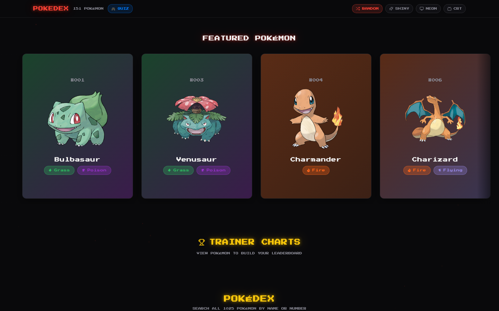
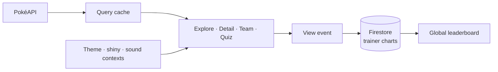

<div align="center">


<p>
  <a href="https://pixel-dex-psi.vercel.app"></a>
  
  
  
</p>

<p><em>A retro-futuristic Pokédex: animated pixel sprites, cinematic parallax, a glowing neon UI and real Pokémon cries,<br>
in a fast, mobile-first React app.</em></p>

<a href="https://pixel-dex-psi.vercel.app"></a>

</div>


## What's inside

| | |
|---|---|
| **Cinematic Pokédex** | A parallax hero, an intro boot animation and a featured carousel of legendaries. |
| **Search and filters** | Instant search by name or number, filtered by type, generation, legendary and mythical. |
| **Deep detail view** | Base stats, abilities, evolution map, move set, size and Pokédex lore. |
| **Real cries** | Every entry plays its authentic cry, with retro UI sound effects. |
| **Trainer Charts** | A global leaderboard of the most-viewed Pokémon, kept in Firebase Firestore. |
| **Who's That Pokémon?** | A silhouette-and-cry quiz with score, streak and high-score tracking. |
| **Team builder** | A six-slot dream team with live type-matchup awareness. |
| **Shiny mode** | One toggle flips every sprite, card and artwork to its shiny variant. |
| **Retro themes** | *Neon* and *Ultra-Retro* themes, an optional CRT scanline effect and hand-made 8-bit icons for all 18 types. |
| **Deep links** | Share any Pokémon at `/pokemon/:id`. |

<table>
  <tr>
    <td width="33%"></td>
    <td width="33%"></td>
    <td width="33%"></td>
  </tr>
  <tr>
    <td align="center"><code>explore</code> · every species</td>
    <td align="center"><code>detail</code> · stats and lore</td>
    <td align="center"><code>quiz</code> · silhouette + cry</td>
  </tr>
</table>


## How it fits together




## Türkçe özet

**Pixel-Dex**, tüm Pokémon'ları tek bir sinematik panelden keşfetmeni sağlayan retro-fütüristik bir Pokédex. Animasyonlu piksel spritelar, gerçek Pokémon sesleri, parlak (shiny) mod, CRT efektli retro temalar ve "Bu Pokémon kim?" oyunu var. En çok görüntülenen Pokémon'lar Firestore üzerinde global bir sıralamada tutuluyor. Mobil öncelikli; giriş gerekmiyor.


## Development

```sh
npm install
npm run dev      # http://localhost:8080
npm test         # vitest
npm run build
firebase deploy --only firestore:rules   # leaderboard rules
```

```
src/components/  hero, cards, detail, team, quiz, type icons
src/contexts/    theme, shiny mode, sound
src/lib/         PokéAPI client, Firestore leaderboard
src/pages/       routes including /pokemon/:id
```

<div align="center">
<br>
<a href="https://github.com/kutluhangil"></a>
<sub>Unofficial fan project · data from PokéAPI · Pokémon and all related names belong to Nintendo, Game Freak and The Pokémon Company.</sub>
</div>
